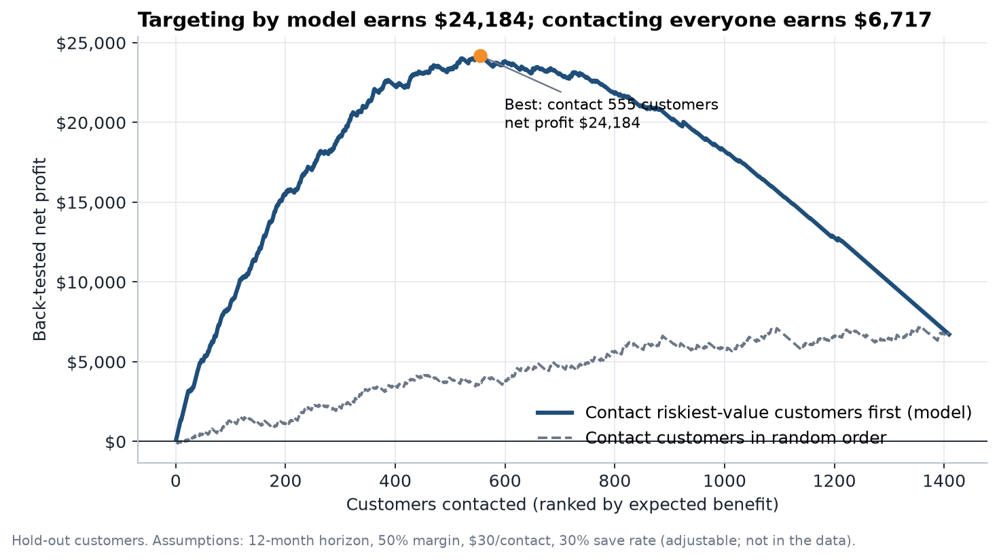
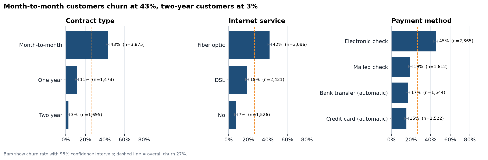
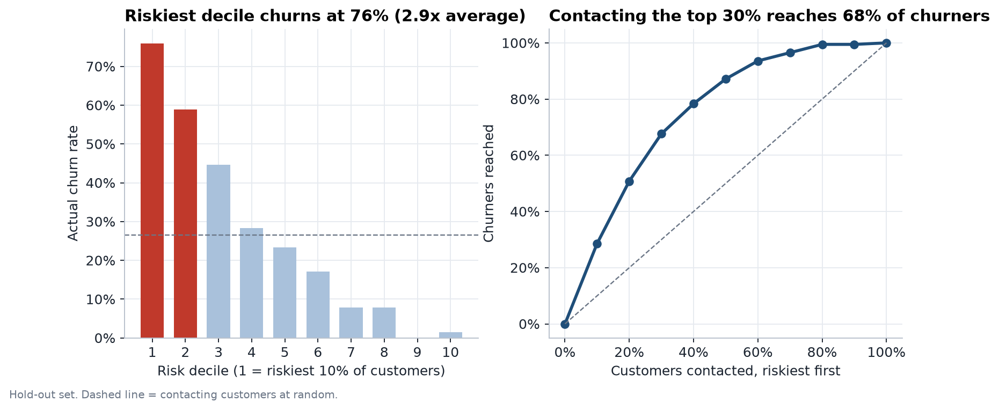
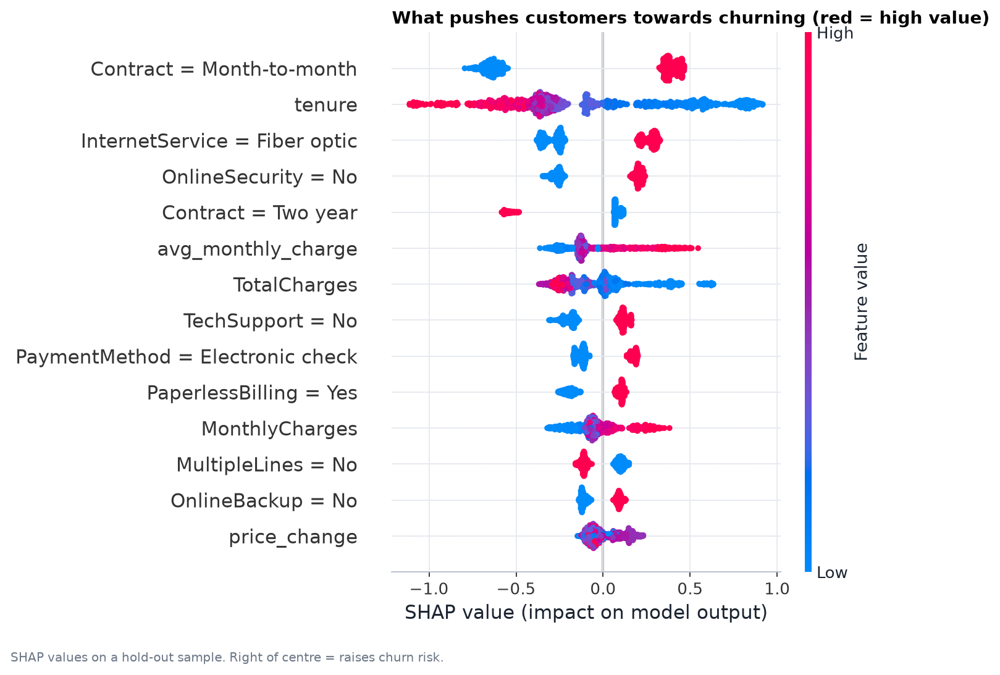
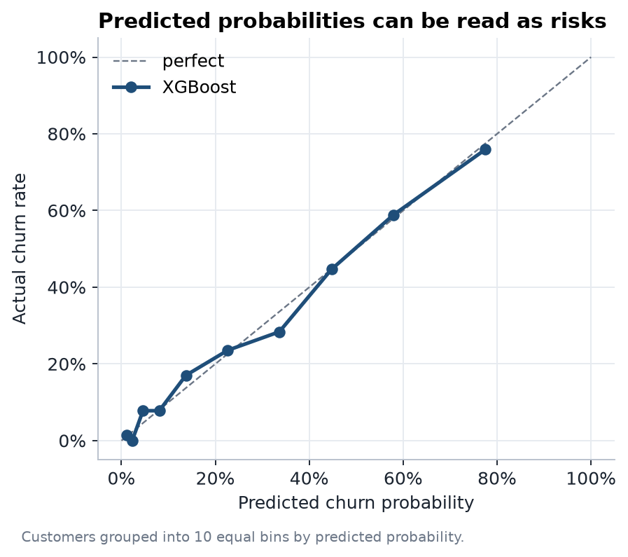
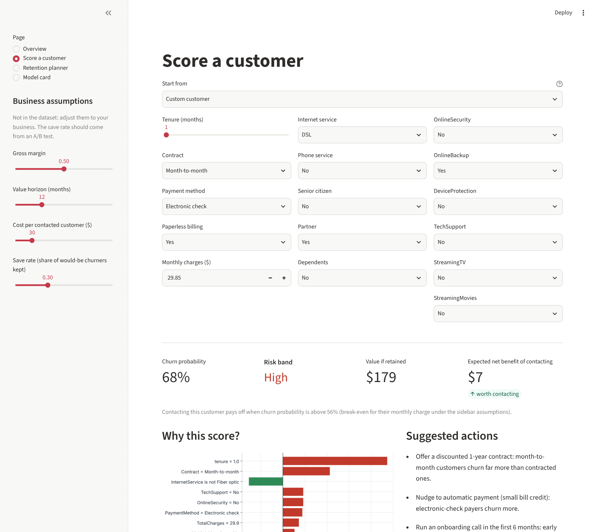

# Telco Customer Churn: Prediction, Explanation and Retention Planner

> Predict which telecom customers are about to leave, explain **why**, and decide **who is worth spending retention money on**. Includes a tested ML pipeline and an interactive Streamlit app.

**Streamlit App link:** https://telco-customer-churn-retention.streamlit.app/ 

**Tech:** Python · pandas · scikit-learn · XGBoost · SHAP · SciPy · Streamlit · pytest

## The business problem

Winning a new customer costs far more than keeping one, but retention offers cost money too. A retention team needs to know three things: **who** is at risk, **what** is driving the risk, and **whether contacting a given customer is profitable**. This project answers all three on the public IBM Telco Customer Churn dataset (7,043 customers, 26.5% churned).

## Results

<!-- RESULTS:START -->
> Figures below were computed on the public **IBM Telco Customer Churn** dataset (7,043 customers).


### Model comparison (5-fold CV on training data, then hold-out test)

| Model | CV ROC-AUC | Test ROC-AUC | Test PR-AUC | Test Brier |
|---|---|---|---|---|
| Baseline (predict base rate) | 0.500 | 0.500 | 0.265 | 0.195 |
| Logistic regression | 0.846 | 0.841 | 0.627 | 0.139 |
| Random forest | 0.847 | 0.844 | 0.655 | 0.136 |
| XGBoost **(selected)** | 0.850 | 0.847 | 0.665 | 0.135 |

### Key findings

1. **The model ranks churners well.** Hold-out ROC-AUC 0.85 and PR-AUC 0.67 (guessing gives 0.27). Probabilities are well calibrated (Brier 0.135).
2. **A small group holds most of the risk.** The riskiest 10% of customers churn at 76% (2.9x the average); contacting the riskiest 30% reaches 68% of churners.
3. **Top drivers.** *Contract*, *tenure*, *InternetService* cause the biggest drop in accuracy when shuffled. This is association, not proof of causation.
4. **Segments.** Churn is highest for *Contract = Month-to-month* (43%) and lowest for *Two year* (3%).
5. **Business impact (back-test, assumptions below).** Targeting the 573 customers whose expected benefit is positive gives $23,644 net profit vs $6,717 for contacting everyone and $2,732 for a same-size random group.

*Assumptions: 12-month horizon, 50% margin, $30 per contact, 30% of would-be churners saved. These are NOT in the data; validate the save rate with an A/B test.*

### Decision at the operating threshold

| Threshold | Precision | Recall | F1 |
|---|---|---|---|
| 0.19 | 0.47 | 0.86 | 0.61 |


<!-- RESULTS:END -->



| | |
|---|---|
|  |  |
|  |  |

## The app

```bash
streamlit run app/streamlit_app.py
```

| Page | What it does |
|---|---|
| **Overview** | Churn KPIs and an interactive segment explorer |
| **Score a customer** | Fill in a customer's details (or start from a real one) and get the churn probability, a SHAP explanation, the expected profit of contacting them and suggested actions |
| **Retention planner** | Adjust margin, offer cost and save rate; see the best campaign size, a back-tested profit curve and a downloadable call list |
| **Model card** | Metrics, model comparison, group checks and limitations |



## How it works

```
Raw CSV -> validate + clean -> engineered features -> 5-fold CV on training data (4 models)
        -> pick best by CV score only -> score untouched test set ONCE
        -> SHAP + permutation importance -> business back-test -> report + Streamlit app
```

Decisions that matter (and why):

| Decision | Reason |
|---|---|
| Preprocessing lives **inside** the sklearn `Pipeline` | The scaler/encoder are re-fitted on each training fold, so nothing leaks from validation data |
| Test set used **once**, model chosen on CV score | Avoids optimistic reporting |
| ROC-AUC, PR-AUC, Brier, lift (not accuracy) | 73.5% of customers stay, so "predict everyone stays" is already 73.5% accurate |
| No class re-weighting / SMOTE | Keeps probabilities **calibrated**, which the money calculation needs |
| `gender` excluded; group metrics reported | A protected attribute with no business reason to be used |
| Blank `TotalCharges` set to 0 only when `tenure == 0` | Those are brand-new, unbilled customers; the code raises an error for any other blank |
| Value-based targeting: `P(churn) x save rate x value - cost` | A cheap customer at 60% risk can be worth less than an expensive one at 40% |
| Out-of-fold scores for every customer | The app's back-test never uses a prediction from a model that saw that customer |

## Assumptions and limitations (read before quoting any number)

* **Margin, offer cost and save rate are assumptions, not data.** The ranking of customers does not depend on them, but the dollar figures do. The save rate should be measured with an A/B test.
* The model finds who is **likely to leave**, not who can be **persuaded to stay**. An uplift model is the next step.
* One snapshot of one sample: no time dimension, and it will not transfer to another company unchanged.
* SHAP and importance describe associations in observational data, not causes.
* `SeniorCitizen` is a model feature. Group metrics are in `reports/fairness_check.csv`; monitor them before any real use.

## Project structure

```
telco-churn-retention/
├── run_pipeline.py            # one command: clean -> EDA -> train -> evaluate -> explain -> report
├── app/streamlit_app.py       # interactive app
├── src/
│   ├── config.py              # paths, column groups, settings
│   ├── download_data.py       # fetch the public dataset
│   ├── data_prep.py           # validation, cleaning, feature engineering
│   ├── features.py            # ColumnTransformer
│   ├── train.py               # CV, tuning, model selection, out-of-fold scores
│   ├── evaluate.py            # metrics, ROC/PR, calibration, lift, group checks
│   ├── explain.py             # SHAP + permutation importance
│   ├── business.py            # expected benefit, targeting, back-test
│   ├── business_plots.py      # campaign profit chart
│   ├── eda.py                 # segment analysis + statistical tests
│   ├── report.py              # writes reports/ and the README results block
│   └── synthetic.py           # offline demo data (tests / --synthetic)
├── tests/test_pipeline.py     # 21 automated checks
├── notebooks/01_churn_analysis.ipynb
├── models/                    # trained pipeline + metadata
└── reports/                   # figures, metrics.json, summary.md, tables
```

## Run it yourself

```bash
python -m venv .venv
# Windows PowerShell:  .venv\Scripts\Activate.ps1      macOS/Linux:  source .venv/bin/activate
pip install -r requirements.txt

python -m src.download_data      # fetches data/raw/Telco-Customer-Churn.csv
python run_pipeline.py           # about 1 minute
pytest -q                        # run the tests
streamlit run app/streamlit_app.py
```

No internet? `python run_pipeline.py --synthetic` generates demo data (every report then carries a "demo data" banner). Alternatively download the file from
[Kaggle](https://www.kaggle.com/datasets/blastchar/telco-customer-churn) and save it as `data/raw/Telco-Customer-Churn.csv`.

## Data

IBM sample dataset "Telco Customer Churn" (public, widely used for teaching). The raw file is downloaded, not committed.

## Author

Kevin Sampath Y
